<a href="https://main.d1w2pd8rw6h4an.amplifyapp.com">
  <picture>
    <source media="(prefers-color-scheme: dark)" srcset="assets/header-dark.svg">
    
  </picture>
</a>

  
  
  
  

## 👋 About me

I'm a Computer Science student at **BITS Pilani** (2023–present) who builds RAG systems, agents and the evals that check them. I try to publish what didn't work next to what did, so the claims below link to where you can verify them.

- 🧪 **Evaluation-first:** my projects ship with eval write-ups, including the failures
- 🌍 **Open source:** 5 merged C/Python PRs in [GRASS GIS](https://github.com/OSGeo/grass) plus work across other projects ([live list below](#-open-source-live))
- 🏆 **Finalist:** Meta PyTorch × OpenEnv Hackathon, Grand Finale
- 🏏 Off the keyboard: cricket and working through maths problems

## 💼 Experience

**AI Engineering Intern · Thriftstone** &nbsp;Remote · Jul 2026 – Oct 2026

- Built a three-tier evaluation framework (extraction, retrieval, agent) for an AI research agent over financial documents: **1,925 golden cases across 16 issuers**, with zero-tolerance gates for abstention and verification
- Diagnosed and fixed verifier, ratio-tool and router defects, such as unit-conversion rounding that misgraded exact figures
- Created and extended deterministic agent tools in a **62-tool registry**, including cash-flow ratios and a multi-period cash-flow bridge
- Worked across retrieval, data pipelines and deployment, including an AWS ECS feature flag and per-user CloudWatch dashboards

## 🌍 Open source: GRASS GIS spotlight

**[OSGeo/grass](https://github.com/OSGeo/grass)**: the open-source GIS used worldwide for geospatial analysis (C, Python).
My headline result: parallelizing `r.resamp.stats` with OpenMP. On a 50M-cell raster the benchmark posted in the PR went from **1.86 s serial to 0.39 s on 10 threads (~4.7×)**.

| PR | What it did |
|:--|:--|
| [#7044](https://github.com/OSGeo/grass/pull/7044) `r.resamp.stats` | OpenMP parallelization with per-thread buffers and memory chunking; benchmark script + pytest suite |
| [#7299](https://github.com/OSGeo/grass/pull/7299) `r.category` | Fixed a maintainer-reported bug where `rules=` wiped the raster title; added regression tests |
| [#7791](https://github.com/OSGeo/grass/pull/7791) `r.resamp.stats` | `quantile` was parsed with `atoi()`, so `method=quantile` silently acted like `minimum`; fixed |
| [#7005](https://github.com/OSGeo/grass/pull/7005) `r.surf.fractal` | Profiled with `gprof`; replaced a manual init loop with `G_zero()` |
| [#7097](https://github.com/OSGeo/grass/pull/7097) `lib` | Replaced unsafe `gets()` with `fgets()` and fixed pointer-type warnings in test programs |

## 📡 Open source, live

Every pull request I've had merged into a repository **I don't own**. This section updates itself from the GitHub API on a schedule.

<picture>
  <source media="(prefers-color-scheme: dark)" srcset="assets/contributions-dark.svg">
  
</picture>

<!-- CONTRIBUTIONS:START -->
| Repository | ⭐ Stars | Merged PRs | Latest merge |
|:--|--:|--:|:--|
|  [OSGeo/grass](https://github.com/OSGeo/grass) | 1.2k | **5** | Aug 2026 |
|  [AidTraceHQ/AidTraceLabs](https://github.com/AidTraceHQ/AidTraceLabs) | 0 | **4** | Nov 2026 |
|  [Altacon-Labs/RevMarket](https://github.com/Altacon-Labs/RevMarket) | 1 | **3** | Nov 2026 |
|  [Indrajeety993648/javascript_Chess](https://github.com/Indrajeety993648/javascript_Chess) | 1 | **3** | Sep 2024 |
|  [Coronasafe/leaderboard-data.old](https://github.com/Coronasafe/leaderboard-data.old) | 5 | **2** | Aug 2024 |
|  [akkuea/akkuea](https://github.com/akkuea/akkuea) | 145 | **1** | Nov 2026 |
|  [storacha/guppy](https://github.com/storacha/guppy) | 16 | **1** | Dec 2025 |
|  [yasharya2901/Python-Price-Scrapper](https://github.com/yasharya2901/Python-Price-Scrapper) | 5 | **1** | Dec 2023 |
|  [llmops-docqa-team/finChat](https://github.com/llmops-docqa-team/finChat) | 0 | **1** | Oct 2026 |
|  [maybeabhinav/bookit](https://github.com/maybeabhinav/bookit) | 0 | **1** | May 2024 |

<b>All 22 merged pull requests</b> (newest first)

- `2026-11-20` **akkuea/akkuea** · [#1404](https://github.com/akkuea/akkuea/pull/1404) feat(shared): validate pilot environment variables in the shared env schema
- `2026-11-20` **Altacon-Labs/RevMarket** · [#52](https://github.com/Altacon-Labs/RevMarket/pull/52) fix(drafts): prevent stale draft edits from overwriting newer revisions
- `2026-11-20` **Altacon-Labs/RevMarket** · [#46](https://github.com/Altacon-Labs/RevMarket/pull/46) feat(backend): online SQLite backup with verified restore and guarded promote
- `2026-11-20` **Altacon-Labs/RevMarket** · [#45](https://github.com/Altacon-Labs/RevMarket/pull/45) feat(service): export settlement evidence by its recorded digest
- `2026-11-19` **AidTraceHQ/AidTraceLabs** · [#94](https://github.com/AidTraceHQ/AidTraceLabs/pull/94) fix: broaden transient database error classification
- `2026-11-19` **AidTraceHQ/AidTraceLabs** · [#97](https://github.com/AidTraceHQ/AidTraceLabs/pull/97) feat: capture and surface the transaction memo for reconciliation
- `2026-11-19` **AidTraceHQ/AidTraceLabs** · [#95](https://github.com/AidTraceHQ/AidTraceLabs/pull/95) fix: prevent removing or demoting the last active admin
- `2026-11-19` **AidTraceHQ/AidTraceLabs** · [#100](https://github.com/AidTraceHQ/AidTraceLabs/pull/100) fix: replace millisecond-timestamp concurrency with a version column
- `2026-10-08` **llmops-docqa-team/finChat** · [#1](https://github.com/llmops-docqa-team/finChat/pull/1) Better answer checks, retrieval for line items, and Show in PDF
- `2026-08-04` **OSGeo/grass** · [#7044](https://github.com/OSGeo/grass/pull/7044) r.resamp.stats: OpenMP parallelization with memory chunking
- `2026-08-03` **OSGeo/grass** · [#7791](https://github.com/OSGeo/grass/pull/7791) r.resamp.stats: Fix quantile option being truncated to an integer
- `2026-04-23` **OSGeo/grass** · [#7299](https://github.com/OSGeo/grass/pull/7299) r.category: preserve raster title when using rules=
- `2026-02-20` **OSGeo/grass** · [#7097](https://github.com/OSGeo/grass/pull/7097) lib: Replace deprecated gets() with fgets() in test files
- `2026-02-04` **OSGeo/grass** · [#7005](https://github.com/OSGeo/grass/pull/7005) r.surf.fractal: Optimize memory initialization using memset
- `2025-12-02` **storacha/guppy** · [#195](https://github.com/storacha/guppy/pull/195) chore: `CONTRIBUTING.md`
- `2024-09-30` **Indrajeety993648/javascript_Chess** · [#7](https://github.com/Indrajeety993648/javascript_Chess/pull/7) "Made Changes in each section"
- `2024-09-26` **Indrajeety993648/javascript_Chess** · [#3](https://github.com/Indrajeety993648/javascript_Chess/pull/3) Horse
- `2024-09-26` **Indrajeety993648/javascript_Chess** · [#1](https://github.com/Indrajeety993648/javascript_Chess/pull/1) Implemented moveTo for Knight
- `2024-08-10` **Coronasafe/leaderboard-data.old** · [#50](https://github.com/Coronasafe/leaderboard-data.old/pull/50) Updating Contributor's data 
- `2024-08-09` **Coronasafe/leaderboard-data.old** · [#52](https://github.com/Coronasafe/leaderboard-data.old/pull/52) Update contributor details
- `2024-05-01` **maybeabhinav/bookit** · [#1](https://github.com/maybeabhinav/bookit/pull/1) feat: created cinemahall workflow
- `2023-12-02` **yasharya2901/Python-Price-Scrapper** · [#1](https://github.com/yasharya2901/Python-Price-Scrapper/pull/1) Updated the file name of files amazon_scrapper.py and flipkart_scrapper.py to amazon.py and flipkart.py

<b>5 pull requests currently in review</b>

- **SkyyNineCrew/Quoin** · [#177](https://github.com/SkyyNineCrew/Quoin/pull/177) fix(contracts): initialize all storage variables in academy-rewards
- **KnightKnight27/Scaler-HFT-2027** · [#108](https://github.com/KnightKnight27/Scaler-HFT-2027/pull/108) Market_data_publisher_10174
- **priyasirohi09/joplin** · [#269](https://github.com/priyasirohi09/joplin/pull/269) Updated empty Trash Functionality
- **priyasirohi09/joplin** · [#79](https://github.com/priyasirohi09/joplin/pull/79) Pencil icon
- **priyasirohi09/joplin** · [#78](https://github.com/priyasirohi09/joplin/pull/78) Updated the font size

Auto-generated from the GitHub API by a scheduled workflow · counts only PRs to repositories I don't own · last updated 2026-11-21
<!-- CONTRIBUTIONS:END -->

## 🚀 Featured projects

<table>
<tr>
<td width="50%" valign="top">

### 🔎 [SourceMind](https://github.com/HUN-sp/SourceMind)
Grounded Q&A over financial PDFs. Every answer cites document and page, and unsupported questions are refused. Hybrid BGE-small + BM25 retrieval with Reciprocal Rank Fusion and two refusal gates.

**Eval (10 questions):** 6 correct · 2 correct refusals · 1 wrong · 1 false refusal. Indexing table rows separately moved retrieval recall from **10/17 to 15/17**. [Eval write-up →](https://github.com/HUN-sp/SourceMind/blob/main/EVALUATION.md)

`Python` `FastAPI` `BM25` `BGE` `RapidOCR` `React`

</td>
<td width="50%" valign="top">

### 🎙️ [AI Persona Chat](https://github.com/HUN-sp/ai-persona-chat)
An AI representative that answers questions about me from my resume and code, declines to invent anything else, and books real interview slots on Google Calendar with a Meet link. Includes a voice mode.

**Manual tests:** relevant chunk in top 3 for 9/10 · 0/5 invented facts on out-of-scope questions · ~1.4 s to first spoken response. [Live →](https://aipersonachat.vercel.app) · [Evals →](https://github.com/HUN-sp/ai-persona-chat/blob/main/EVALS_REPORT.md)

`Next.js` `TypeScript` `Cohere rerank` `Groq` `Vapi`

</td>
</tr>
<tr>
<td width="50%" valign="top">

### 🏆 [PhonePilot](https://github.com/Pranav-1100/meta-rl-project): hackathon finalist
Team of 3 at the **Meta PyTorch × OpenEnv Hackathon Grand Finale**. An RL environment that tests LLM agents for dishonesty: false completion claims, unsupported facts and sycophancy. I drafted early reward-design ideas that the team adopted.

[Live env →](https://huggingface.co/spaces/pranav-1100/phonepilot) · [Trained model →](https://huggingface.co/vinnykc08/phonepilot-gemma9b)

`PyTorch` `RL` `OpenEnv` `Gemma`

</td>
<td width="50%" valign="top">

### 🗺️ [Aadhaar Seva Radar](https://github.com/HUN-sp/Aadhar-_Seva-_Radar)
UIDAI Data Hackathon: where do child biometric updates lag behind enrolments? Merged **~4.9M rows** into **31,777 pincodes** and flagged Thane as Maharashtra's top red-zone district (12.0× updates per enrolment vs a 20.7× state average).

The thresholds are hand-chosen and unvalidated, so the ranking is a starting point for questions, not a finding.

`Python` `pandas` `NumPy` `Matplotlib`

</td>
</tr>
</table>

<b>More things I've built</b>

- **[minimi-chat-agent](https://github.com/HUN-sp/minimi-chat-agent)**: a chat agent with live web search and time-aware memory that re-checks earlier answers against today's sources (Node, TypeScript, Groq, Tavily, SQLite)
- **[Market_Data_Publisher](https://github.com/HUN-sp/Market_Data_Publisher)**: a C++17 publisher that sends simulated ticks over a lock-free ring buffer in POSIX shared memory and over TCP (no latency claims yet)
- **[Portfolio](https://github.com/HUN-sp/vinay-s-portfolio)**: Vite + React + TypeScript, hosted on AWS Amplify

## 🛠️ Tech stack

   
  

**AI / evaluation:** RAG · hybrid retrieval (BM25 + dense) · BGE & Cohere embeddings · reranking · OCR · retrieval testing · A/B comparison · error analysis · CrewAI · LangGraph · Langfuse

## 🐍 Contribution activity

<picture>
  <source media="(prefers-color-scheme: dark)" srcset="assets/snake-dark.svg">
  
</picture>

---

  <b>Let's talk.</b> Reach me on <a href="https://www.linkedin.com/in/vinay-kumar-chopra-307976286/">LinkedIn</a>, or see everything on my <a href="https://main.d1w2pd8rw6h4an.amplifyapp.com">portfolio</a>.

